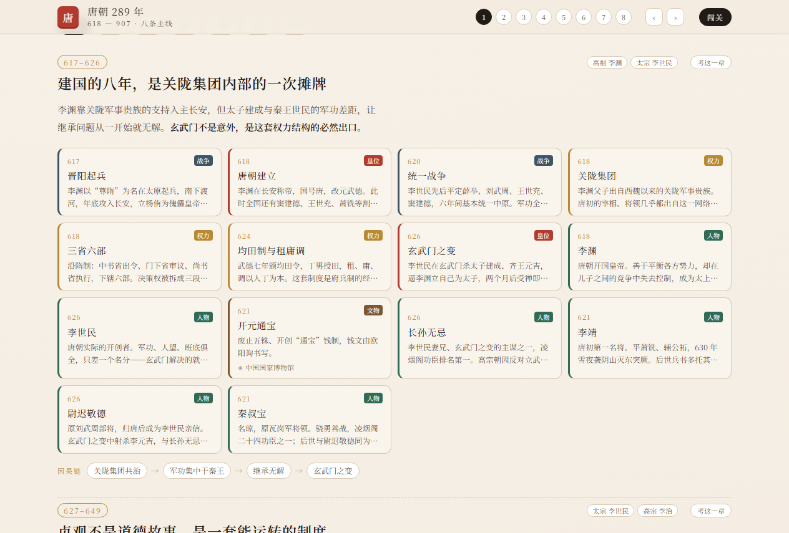
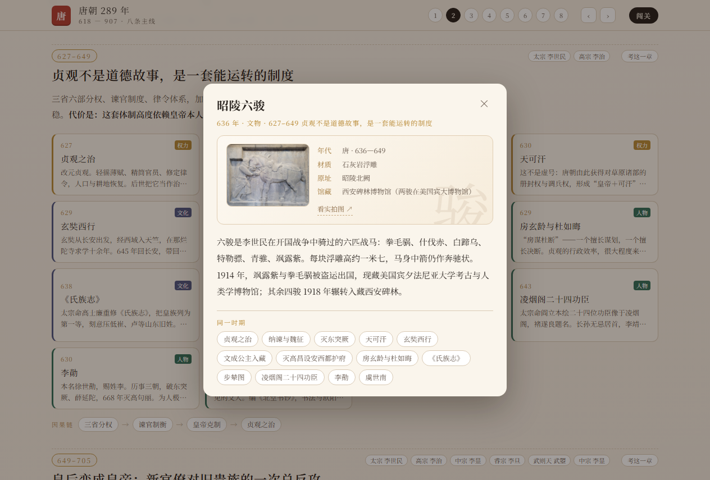
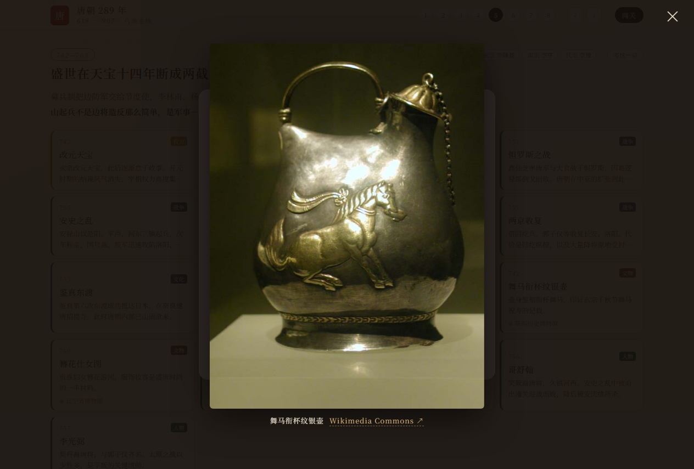
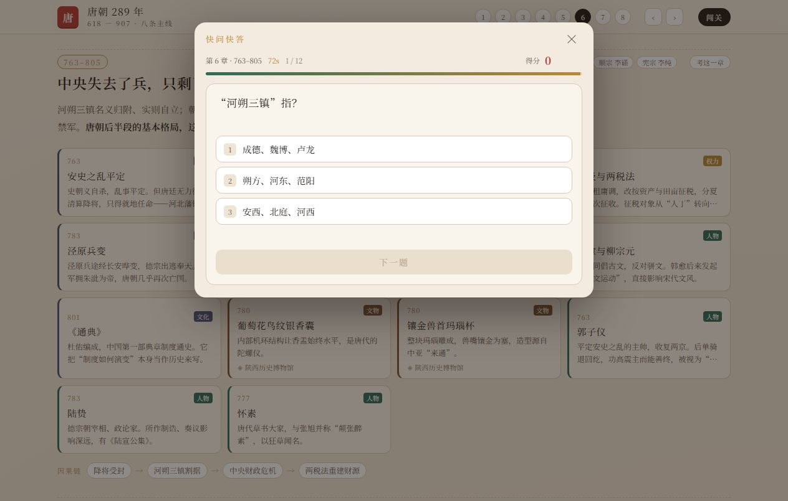

# 唐朝 289 年 · 历史学习站

一个离线可用的中国朝代史学习项目：**把唐朝当成一个可读、可练、可查的整体**，而不是一张年表。

打开 `tang-map/index.html` 就能用，不需要构建、不需要联网、不需要服务器。


## 它包含什么

### 1. 皇位更替 —— 中轴左右交替的竖时间轴

23 次即位，21 位皇帝。每一条包含：在位年份、庙号、姓名、别称（天可汗 / 唐明皇 / 小太宗…），以及最多三条治世评价或大事（贞观之治、安史之乱、甘露之变…）。

- 底色区分 **治世 / 平稳 / 乱局**
- 红点标记 **非正常继位**（政变、拥立、自立、代唐、禅让）
- 顶部直接给出结论：**23 次即位，其中 15 次非正常**

### 2. 八章主线 —— 每章一个论点，而不是事件列表

| 章 | 年份 | 论点 |
|---|---|---|
| 一 | 617–626 | 建国的八年，是关陇集团内部的一次摊牌 |
| 二 | 627–649 | 贞观不是道德故事，是一套能运转的制度 |
| 三 | 649–705 | 皇后变成皇帝：新官僚对旧贵族的一次总反攻 |
| 四 | 705–741 | 两次政变，换来四十年盛世 |
| 五 | 742–763 | 盛世在天宝十四年断成两截 |
| 六 | 763–805 | 中央失去了兵，只剩下钱和名分 |
| 七 | 805–835 | 最后一次主动出击，然后彻底失手 |
| 八 | 835–907 | 不是亡于一场叛乱，而是亡于没人能再统一 |

每章末尾有一条**因果链**（如 `府兵瓦解 → 节度使掌兵财 → 中央失去制衡 → 安史之乱`）。

### 3. 115 张卡片，六种线

**皇位 · 权力 · 战争 · 人物 · 文化 · 文物**，可按类型筛选，只看其中一条线。



人物覆盖 31 位：凌烟阁二十四功臣、李靖、苏定方、薛仁贵、郭子仪、李光弼、杨贵妃、太平公主、吴道子、王维、怀素、李德裕、张议潮……

### 4. 文物展签

12 件唐代名物，按博物馆展签的格式呈现：**年代 / 材质 / 出土地 / 馆藏**，配 150–200 字科普。



9 件带馆藏照片，点开可全屏查看：



照片来自 Wikimedia Commons，大图页附文件页链接（作者与许可见该页）。断网或加载失败时自动退回器物字占位，不会出现碎图。

### 5. 闯关练习

119 道题，全部锚定可查证的事实，答错立刻给正解、解释和出处。

- **快问快答**：60 秒，连击加分，选项每次重新洗牌
- **时间轴插卡**：19 个事件，3 条命
- **联想发散**：9 个类目，45 秒
- **考这一章**：每章标题右侧，只抽该章题目，答完自动结束



## 快速开始

```bash
git clone git@github.com:lazypusher/Dynasty-history-track.git
cd tang-dynasty-atlas
```

直接双击 `tang-map/index.html` 即可（纯静态、零依赖，数据内联在文件里）。

`tang-quiz/index.html` 是同一套游戏的独立版本，可单独打开。

## 目录

```
.
├── 中国朝代史自学手册.md      # 六周自学方案、卡片模板、可信度纪律
├── tang-map/
│   ├── index.html            # 主应用（时间轴 + 八章 + 闯关）
│   ├── e2e.mjs               # 端到端测试（75 项，需本机 Chrome）
│   └── shots/                # 截图
└── tang-quiz/
    ├── index.html            # 独立版闯关
    ├── check.mjs             # 题库与语法校验
    └── e2e.mjs
```

## 数据结构

全部数据在 `tang-map/index.html` 顶部的几组常量里，改成别的朝代只需要换数据：

- `EMPS` — 皇帝：`{n:庙号, p:姓名, y0, y1, al:别称, ab:非正常继位, k:盛/稳/乱, tags:[≤3条]}`
- `CH` — 章节：`{id, y, s, e, t:论点, lead, items:[...], chain:[...]}`
- 卡片 item：`{t, y, k:emp|pow|war|ppl|cul|rel, d, long?, mus?, facts?, img?}`
- `QB` — 题库：`{y, q, o:[选项], a:正确项, n:解释, s:出处}`
- `EVENTS` / `CATS` — 时间轴插卡与联想发散

## 测试

```bash
cd tang-map && node e2e.mjs
```

需要本机装有 Chrome（脚本用 CDP 驱动）。75 项检查覆盖时间轴、章节、文物展签、图片退化、闯关流程、题库一致性。

## 内容说明

- 史实以《旧唐书》《新唐书》《资治通鉴》《唐六典》《通典》等为主，出处标注到书名一级。
- 年份、馆藏等信息如发现错误，欢迎提 issue。
- 文物照片版权归原作者，均来自 Wikimedia Commons，许可见对应文件页；本项目仅作个人学习用途。
- 代码 MIT，文字内容可自由使用（注明出处即可）。

## License

MIT
