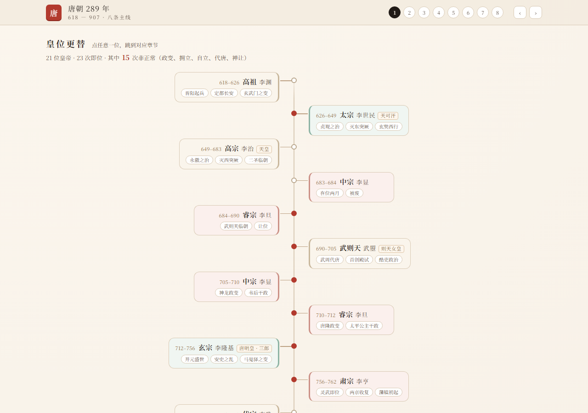

# 中国朝代史 · 可视化学习站

按中国王朝更替的顺序，**每个朝代一页**：皇位更替时间轴、主线章节、人物与文物卡片、闯关练习。
纯静态、零依赖，双击根目录的 `index.html` 先看纵览，点任意一朝进入。

**首页 `index.html`** 是一条按年数等比的长卷：色块的长度就是该朝代的年数（夏 470 年、秦 15 年），下面按「先秦 / 秦汉 / 魏晋南北朝 / 隋唐 / 五代宋辽金 / 元明清」六段列出十八个时期，点哪一条进哪一页。

首页是**单文件自包含**的（数据内联，无任何外部脚本）；跳转用 `#d=<id>` 哈希，不依赖查询参数。朝代页同时接受 `?d=` 与 `#d=`。

另外，朝代页右上角的**「纵览」不是跳转**，而是就地弹出同一个纵览浮层（等比长卷 + 18 行列表），选完直接在该页重渲染——不换文档、不改地址，宿主环境再严格也不会白屏。

目前已建成 **18 个时期，从夏到清全部完成**——朝代条上不再有「筹备中」的占位。



## 页面结构

顶部是**朝代切换条**，按时间顺序排列：夏 商 西周 春秋 战国 秦 汉 三国 晋 隋 唐 五代十国 宋 辽 金 元 明 清。
点哪个朝代就**就地重渲染**该朝数据（不跳转、不刷新），地址栏同步为 `?d=<id>`；没建好的朝代是虚线灰字。

每一页都包含五块：

### 1. 皇位更替 —— 中轴左右交替的竖时间轴

每位君主一条：在位年份、庙号、姓名、别称，以及最多三条治世评价或大事。
底色区分 **治世 / 平稳 / 乱局**，红点标记 **非正常继位**，顶部给出统计。

### 2. 主线章节 —— 每章一个论点

以唐为例：八章各有一句论点、一段导语，末尾一条**因果链**（如 `府兵瓦解 → 节度使掌兵财 → 中央失去制衡 → 安史之乱`）。

### 3. 卡片：六条线

**皇位 · 权力 · 战争 · 人物 · 文化 · 文物**，可单独筛选。

### 4. 文物展签

按博物馆展签格式：**年代 / 材质 / 出土地 / 馆藏** + 科普长文。全部 18 个时期共 57 件文物，其中 **53 件配有馆藏照片**，点开可全屏放大（图片来源 Wikimedia Commons，图源页附作者与许可）。

### 5. 闯关

- 快问快答（连击加分，选项每次洗牌）
- 时间轴插卡（3 条命）
- 联想发散（同类检索）
- **考这一章**：每章标题右侧，只抽该章题目，答完自动结束

## 各朝代数据

| 时期 | 君主 | 章节 | 卡片 | 题目 | 事件 |
|---|---|---|---|---|---|
| 夏（约前2070—前1600） | 10 | 3 | 19 | 19 | 12 |
| 商（约前1600—前1046） | 8 | 4 | 25 | 24 | 12 |
| 西周（前1046—前771） | 13 | 4 | 24 | 26 | 12 |
| 春秋（前770—前476） | 9 | 4 | 26 | 29 | 12 |
| 战国（前475—前221） | 8 | 4 | 25 | 27 | 14 |
| 秦（前221—前206） | 3 | 3 | 25 | 21 | 13 |
| 汉（前202—220） | 22 | 6 | 63 | 46 | 17 |
| 三国（220—280） | 10 | 4 | 24 | 27 | 12 |
| 晋（265—420） | 12 | 4 | 24 | 27 | 12 |
| 隋（581—618） | 3 | 4 | 28 | 26 | 13 |
| 唐（618—907） | 23 | 8 | 115 | 119 | 19 |
| 五代十国（907—960） | 15 | 4 | 23 | 27 | 12 |
| 宋（960—1279） | 18 | 6 | 52 | 43 | 14 |
| 辽（916—1125） | 9 | 4 | 21 | 25 | 12 |
| 金（1115—1234） | 9 | 4 | 21 | 26 | 13 |
| 元（1271—1368） | 8 | 4 | 29 | 28 | 12 |
| 明（1368—1644） | 17 | 7 | 59 | 47 | 15 |
| 清（1636—1912） | 11 | 6 | 44 | 37 | 21 |

合计 **18 个时期、83 章、647 张卡片、624 道题**。

## 两条看历史的路

**按朝代看**：顶部的朝代条，或右上角「纵览」——一条按年数等比的长卷，点哪段进哪朝。

**按主题看**：右上角「主题」——换一条线，看同一件事在几百年里怎么被反复处理：

| 主题 | 节点 |
|---|---|
| 变法 | 李悝 → 商鞅 → 王莽 → 孝文帝 → 庆历 → 王安石 → 张居正 → 戊戌 |
| 选官 | 世卿世禄 → 察举 → 九品中正 → 进士科 → 殿试 → 糊名誊录 → 八股 → 废科举 |
| 运河 | 邗沟 → 灵渠 → 隋大运河 → 裴耀卿漕运 → 元京杭 → 明会通河 → 黄河改道 → 停漕 |
| 和议 | 弭兵之会 → 澶渊 → 绍兴 → 隆兴 → 嘉定 → 南京条约 → 马关 → 辛丑 |
| 币制 | 半两 → 五铢 → 开元通宝 → 交子 → 至元宝钞 → 大明宝钞 → 龙洋 |

每个节点都能点，直接跳到对应朝代页的那一章。

## 闯关有四种玩法

快问快答（本朝题库）、时间轴插卡（事件排序）、联想发散（同类检索），以及**通史卷**——从 12 个时期各抽一题，答错的那道会带一个「去看这一节」的按钮，一键跳到那个朝代的对应章节。

## 快速开始

```bash
git clone git@github.com:lazypusher/Dynasty-history-track.git
cd Dynasty-history-track
```

双击根目录 `index.html` 看纵览；也可以直接打开某一朝（默认唐）：

```
tang-map/index.html?d=qin
tang-map/index.html?d=han
tang-map/index.html?d=song
tang-map/index.html?d=qing
```

上次看过的朝代会被记住（localStorage），下次打开直接进入。

## 目录

```
.
├── index.html                  # 首页：朝代纵览（等比长卷 + 分组列表）
├── 中国朝代史自学手册.md        # 六周自学方案、卡片模板、可信度纪律
├── tang-map/
│   ├── index.html              # 壳层：渲染引擎 + 选朝条
│   ├── data/
│   │   ├── dynasties.js        # 朝代清单 + 唐
│   │   └── chunqiu / zhanguo / qin / han / sanguo / jin /
│   │       sui / wudai / song / liao / jin2 / yuan / ming / qing
│   ├── check-data.mjs          # 数据校验（结构 / 年份 / 题库覆盖）
│   ├── e2e.mjs                 # 端到端测试（唐，75 项）
│   └── shots/
└── tang-quiz/                  # 独立版闯关（旧）
```

## 加一个朝代

1. 新建 `data/<id>.js`，写 `window.DYNASTIES.<id> = { meta, emps, chapters, questions, events, cats }`
2. 在 `index.html` 里加一行 `<script src="data/<id>.js"></script>`
3. 确认该 id 已在 `data/dynasties.js` 的 `DYNASTY_LIST` 中

数据结构：

- `emps[i]` — `{n:庙号, p:姓名, y0, y1, m:继位说明, k:"盛"|"稳"|"乱", ab:1, al:别称, tags:[≤3]}`
- `chapters[i]` — `{id, y, s, e, t:论点, lead, items:[], chain:[]}`
- `items[j]` — `{t, y, k:"emp|pow|war|ppl|cul|rel", d, long?, mus?, facts?, img?}`
- `questions[i]` — `{y, q, o:[选项], a:正确项, n:解析, s:出处}`
- 年份用负数表示公元前（`-202` = 公元前 202 年）

写完跑 `node check-data.mjs`，它会检查：章节年份递增、卡片年份落在所属章节区间、题目答案下标、题干重复、每章题目数 ≥6、事件按年递增等。

## 测试

```bash
cd tang-map
node check-data.mjs     # 数据一致性
node e2e.mjs            # 页面行为（需本机 Chrome）
```

## 内容说明

- 史实以正史（《史记》《汉书》《旧唐书》《宋史》《明史》等）为主，出处标注到书名一级。
- 年份、馆藏等信息如有错误，欢迎提 issue。
- 文物照片来自 Wikimedia Commons，许可见对应文件页；本项目仅作个人学习用途。
- 代码 MIT，文字内容可自由使用（注明出处即可）。

## License

MIT
